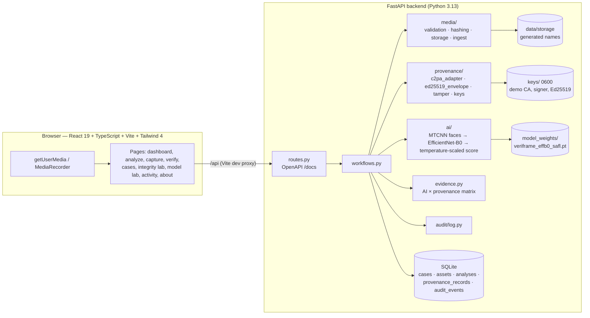

# Architecture

## Request flows

**Analyze** (`POST /api/analyze`): read upload with byte cap → magic-byte sniff → full decode (images) / OpenCV probe (videos) → SHA-256 + pHash → store under a UUID name → **AI job** (faces → crops → classifier; or ≤16 evenly sampled video frames) → **provenance job** (C2PA reader) → evidence matrix → persist case, analysis, provenance record, audit events → return the case.

**Sign** (`POST /api/provenance/sign`): ingest → C2PA Builder (CREATE/digitalCapture for browser capture, EDIT/parentOf for uploads) → ES256 sign + embed → Ed25519 envelope over signed bytes → **re-verify through the verifier** → persist.

**Verify** (`POST /api/provenance/verify`, `POST /api/provenance/verify-ref/{ref}`): C2PA reader (embedded or `.c2pa` sidecar) and optional envelope → status + steps + pHash nearest stored asset. No AI involvement.

**Integrity lab** (`POST /api/integrity/tamper-demo`): sign → verify → byte tamper copy → verify → visual edit copy → verify → SHA-256/pHash comparisons.

## Separation of concerns

| Layer | Responsibility | Never does |
|---|---|---|
| `media/` | Validate, decode, hash, store | Trust filenames or client MIME types |
| `ai/` | Produce a model score or an explicit unavailable/inconclusive state | Fabricate scores; read provenance |
| `provenance/` | Sign/verify; keep validity and trust separate | Use pHash for integrity; expose private keys |
| `evidence.py` | Map (AI verdict, provenance status) to a readable summary | Compute a single truth score |
| `audit/` | Persist events | Log media bytes, keys or absolute paths |

## Data model

* `cases(id uuid-hex, kind, title, media_type, is_sample, sample_label, sample_source, summary JSON)`
* `assets(id, case_id, role[original|signed|envelope|tampered_bytes|tampered_visual], stored_name, display_name, mime, size, sha256, phash, w, h, duration)`
* `analyses(id, case_id, asset_id, status, verdict, reason, score, threshold, model_name, model_version, details JSON, duration_ms)`
* `provenance_records(id, case_id, asset_id, operation[sign|verify|tamper_test], status, signature_valid, signer_trusted, signer, details JSON)`
* `audit_events(id, ts, action, case_id, result, details JSON)`

Share references (`VF-XXXXXXXX-XXXX`) are the first 12 hex characters of the 128-bit case UUID; full IDs are unguessable.

## Frontend structure

`src/lib/api.ts` (typed client), `src/lib/format.ts` (status vocabulary), `src/components/` (layout shell, UI primitives, evidence panels, evidence matrix, signing/lab result views), `src/pages/` (one file per route). TanStack Query handles server state; Sonner provides toasts; Recharts draws only stored data.

Design system: ink (#0E1726) chrome on a cool paper canvas; **cyan "signal" = AI evidence channel, violet "seal" = provenance channel**, used consistently in panels, charts, matrix axes and timeline dots; viewfinder corner brackets frame every media preview; Instrument Sans for UI, JetBrains Mono only for digests and codes.
